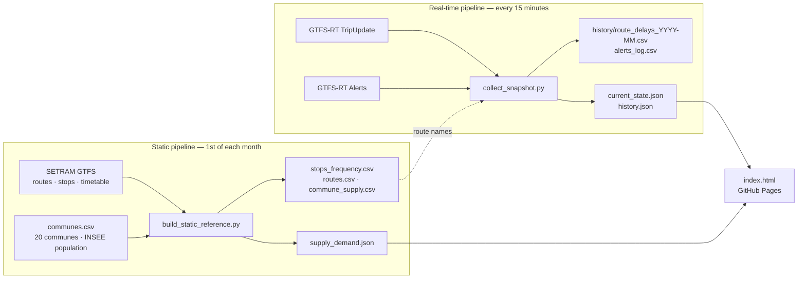

# Smart Mobility Le Mans

**TD2 · Business Intelligence** — two automated pipelines on SETRAM's open data (Le
Mans bus and tram network) feeding one decision dashboard.

### [Open the live dashboard](https://adam-hassen-bi.github.io/smart-mobility-lemans-TD2/)

https://adam-hassen-bi.github.io/smart-mobility-lemans-TD2/

> **The decision it supports:** if Le Mans Métropole had limited resources to
> improve its public transport network, **where and when** should it prioritize
> interventions?

Two honest limits shape everything below: no transit agency publishes real
ridership, so demand is approximated by **population**; and the real-time feed keeps
**no history**, so recurring patterns only exist because this pipeline records them.

---

## How it works



| BI stage | What happens | Where |
|---|---|---|
| **Acquisition** | Two cadences on the same kind of source: the static GTFS timetable pulled monthly, the live GTFS-RT feeds (protobuf, no key) pulled every 15 min; INSEE population as enrichment | `scripts/*.py`, `data/reference/communes.csv` |
| **Cleaning** | Every GTFS file read with `dtype=str`, so IDs like `1001` and `FLEX-381` join correctly; representative weekday = the Tuesday service with the longest validity | `build_static_reference.py` |
| **Transformation** | Scheduled trips per stop, nearest commune per stop, supply per 1,000 residents; per-route delay summary for each snapshot | both scripts |
| **Storage** | Raw history appended, never overwritten, one CSV per month, **one row per route per snapshot** (not per stop) to keep the file small | `data/history/` |
| **Visualization** | Live KPIs, delays by route, 7-day history, supply vs population | `docs/index.html` |
| **Automation** | Two GitHub Actions on different schedules, each committing its own output | `.github/workflows/` |

## The dashboard

**Right now**
- **Freshness badge** — orange when the latest snapshot is more than an hour old, so
  a stopped pipeline is visible without opening the Actions tab.
- **KPIs** — network average delay, routes more than 3 min late, most delayed route,
  active alerts — plus an alert banner.
- **Delay by route** — a diverging chart around zero with an on-time band (1 min
  early to 3 min late). The **Early / late ↔ Off schedule** toggle switches to a
  passenger view where running early counts as badly as running late.
- **Routes to watch** — worst routes with their worst trip, number of trips and
  skipped stops.

**Over time** (builds up automatically)
- **Network delay over the last 7 days**, one point per snapshot.
- **When is it worst?** — average delay by hour of day, Le Mans time.
- **Routes repeatedly late** — share of snapshots where each route was more than
  3 minutes late.

**Supply vs. where people live**
- **Scheduled stop-visits per 1,000 residents** for the 20 communes, against the
  network average.
- **Map** of all served stops (sized by weekday visits) and communes (shaded by
  supply per resident).
- **Commune table** with **caution flags** where the number should not be trusted:
  very few stops, one stop driving the figure, or stops borrowed from Le Mans.

Works on mobile and follows the system light / dark mode.

## KPI definitions

| KPI | Definition |
|---|---|
| Delay | real minus scheduled time of a stop-time update (negative = early) |
| Route delay | average over all the route's updates in one snapshot |
| Network delay | average over **all** updates (each update weighs the same) |
| On time | between 1 minute early and 3 minutes late |
| Late route | route averaging more than 3 minutes late in a snapshot |
| Supply | scheduled stop-visits on a representative weekday, summed per commune |
| Supply per resident | stop-visits per 1,000 residents (INSEE population) |

The TD's original `network_avg_delay_s` (an unweighted average of route averages) is
kept in `current_state.json`; the dashboard uses the weighted version, which is not
pulled down by small routes with only a couple of trips.

## Run it locally

```bash
git clone https://github.com/adam-hassen-Bi/smart-mobility-lemans-TD2.git
cd smart-mobility-lemans-TD2
python3 serve.py              # opens the dashboard on http://localhost:8000
```

To take a fresh real-time snapshot before opening it:

```bash
pip3 install requests pandas gtfs-realtime-bindings
python3 serve.py --refresh
```

> Opening `docs/index.html` by double-click does not work: the page loads its data
> with `fetch()`, which browsers block on `file://`.

## Automation

| Workflow | Schedule | Output |
|---|---|---|
| **Build static reference** | 04:00 UTC on the 1st of each month + manual | `data/gtfs_static/`, `docs/data/supply_demand.json` |
| **Collect realtime snapshot** | every 15 minutes + manual | `data/history/`, `docs/data/current_state.json`, `docs/data/history.json` |

Both can be started from the **Actions** tab (*Run workflow*). They need *Settings →
Actions → General → Workflow permissions → Read and write*. Each workflow runs one
copy at a time and pulls before pushing, so the two never overwrite each other's
commits. GitHub may delay scheduled runs at busy times, and it disables them after
60 days without repository activity — the freshness badge makes both visible.

## Repository layout

```
.github/workflows/build_static_reference.yml   monthly static pipeline
.github/workflows/collect_snapshot.yml         15-minute real-time pipeline
data/reference/communes.csv                    20 communes, coordinates, population
data/gtfs_static/                              generated: stops, routes, commune supply
data/history/                                  generated: route delays per month, alerts
scripts/build_static_reference.py
scripts/collect_snapshot.py
docs/index.html                                dashboard (GitHub Pages source)
docs/data/                                     generated JSON read by the dashboard
serve.py                                       local preview
REFLECTIONS.md                                 answers to the 11 TD questions
```

## Limits

- **Population is not demand.** Event areas (circuit, stadium, exhibition centre)
  have few residents and huge peaks; car-dependent communes the opposite.
- **Stops are assigned to the nearest commune centre**, not to the commune they are
  in. Small communes next to Le Mans pick up its outer stops and look over-served,
  while Le Mans looks under-served. Real commune boundaries would fix this.
- **Per-route history** cannot say *where on a route* delays build up.
- **Small samples**: a route observed with one or two trips can show an extreme
  average; tooltips show the number of trips and updates behind every figure.

## Credits

Data: SETRAM via [transport.data.gouv.fr](https://transport.data.gouv.fr) (GTFS and
GTFS-RT, Licence Ouverte), INSEE legal population · Map tiles: © OpenStreetMap
contributors © CARTO · Map library: Leaflet.
